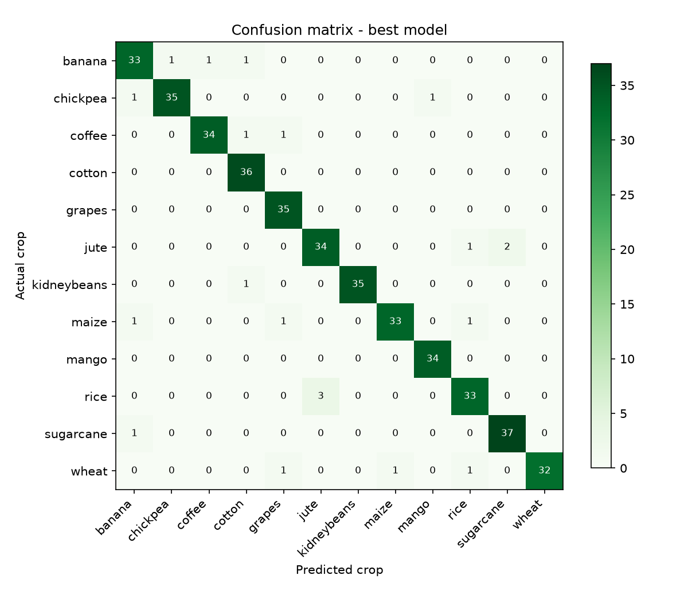
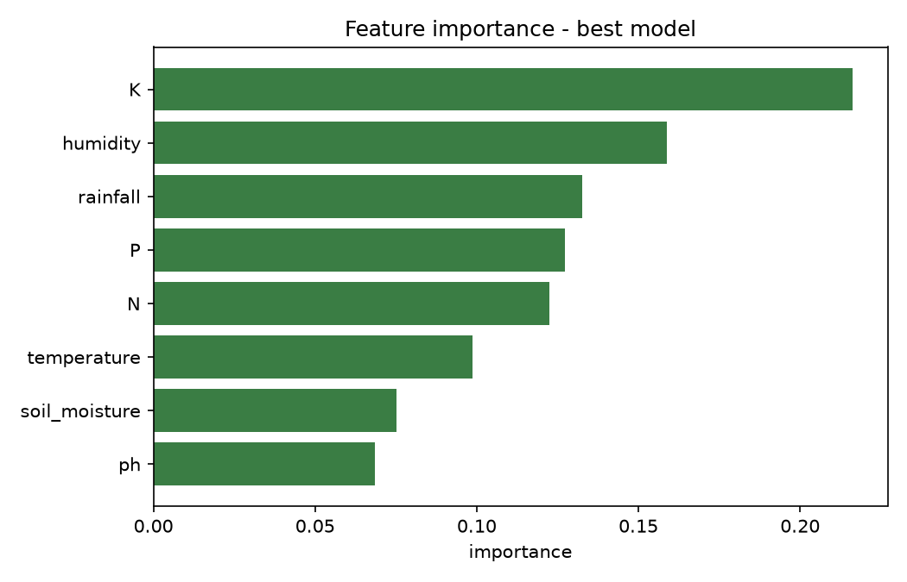

# AgriSense AI — Soil Classification & Crop Recommendation

[](https://github.com/tanviwadgaonkar/agrisense-ai/actions/workflows/ci.yml)

End-to-end machine-learning application that **classifies soil condition**
(rule-based agronomy report: pH class, N/P/K levels, moisture state) and
**recommends the best crops** (ML classifier) from soil-test values —
N, P, K, pH, soil moisture — plus environmental attributes (temperature,
humidity, rainfall).

> Related publication: *soil classification and crop recommendation*,
> accepted for presentation at **ICAIMEST-2026**.

## How it works

```
soil test values ──► validate (finite, physical ranges) ──► scale (saved scaler)
   (form / JSON / CLI)  ├─► rule-based soil report (pH / N / P / K / moisture)
                        └─► ML model (best of LR / RF / GB by CV) ──► top-3 crops + probabilities
                                          │
                     Flask: HTML form · POST /api/recommend · GET /health
```

- `data/make_dataset.py` — builds the sample dataset (2,160 rows, 12 crops, 8 features)
- `src/preprocess.py` — cleaning, input validation (shared physical limits), stratified split, scaling (no disk writes)
- `src/train.py` — compares 3 models with leakage-free 5-fold CV, picks the best by CV, saves model + scaler + metrics + plots
- `src/soil_rules.py` — agronomy rules for soil condition classification
- `src/predict.py` — shared inference (CLI + app), top-k crops with probabilities
- `app/app.py` — Flask UI, JSON API, and an image-upload endpoint for the planned disease model

## Results (test set, sample dataset)

| Model | 5-fold CV macro-F1 (train) | Test accuracy | Test precision (macro) | Test recall (macro) | Test F1 (macro) |
|---|---|---|---|---|---|
| Logistic Regression | 0.904 ± 0.014 | 91.20% | 0.913 | 0.912 | 0.912 |
| **Random Forest** ✅ | **0.940 ± 0.010** | **95.14%** | **0.953** | **0.952** | **0.952** |
| Gradient Boosting | 0.925 ± 0.008 | 93.98% | 0.941 | 0.940 | 0.940 |

The model is **selected on cross-validation over the training split only**; the 432-row test split is touched once, for the numbers above. Inside CV the scaler is part of a pipeline, so each fold is scaled using only its own training rows.




> **Note on data:** the included dataset is a synthetic sample with the same
> schema as the study dataset (generated in `data/make_dataset.py` from
> per-crop agronomic ranges, with label noise). To reproduce the paper's
> numbers, place the study CSV at `data/soil_data.csv` and re-run training —
> all metrics, plots and the README table regenerate from `models/metrics.json`.

## Run it

```bash
pip install -r requirements.txt

python data/make_dataset.py     # or drop in your own soil_data.csv
python -m src.train             # trains, compares, saves best model
python -m src.evaluate          # classification report for the saved model (writes nothing)
pip install -r requirements-dev.txt
python -m pytest -q             # 22 tests

python -m app.app               # Flask UI at http://localhost:5000 (FLASK_DEBUG=1 for debug mode)
```

CLI prediction:

```bash
python -m src.predict --N 78 --P 42 --K 40 --temperature 24 \
  --humidity 82 --ph 6.4 --rainfall 220 --soil_moisture 68
```

JSON API:

```bash
curl -s localhost:5000/api/recommend -H "Content-Type: application/json"   -d '{"N":78,"P":42,"K":40,"temperature":24,"humidity":82,"ph":6.4,"rainfall":220,"soil_moisture":68}'
# -> {"recommendations":[{"crop":"rice","probability":...}, ...], "soil":{...}}
# invalid input -> 422 {"error":"ph must be between 3 and 10"}
```

## Engineering notes

- **One set of physical limits** (`LIMITS` in `src/preprocess.py`) cleans the training data *and* validates every request, so the model is never asked about inputs outside what it was trained on (e.g. pH 99, negative nitrogen, NaN).
- **Artifacts are written in one place.** Only `src/train.py` writes `models/`. Evaluation and tests load the saved model and scaler, so they measure exactly what the app serves and can't desynchronise the pair.
- **Pickle compatibility.** `metrics.json` records the Python and scikit-learn versions used for training, and `requirements.txt` pins scikit-learn to that minor version.
- **Tests (22)** cover data cleaning, stratified splitting, the soil rules, prediction ranking, input validation (form and JSON), the accuracy floor of the saved model, that splitting never writes artifacts, and the upload checks on `/predict-disease`.

## Status of plant-disease detection

`POST /predict-disease` validates an uploaded leaf image (JPEG/PNG, ≤ 5 MB, decodable) but **no disease model is trained yet**, so a valid image returns `501 Not Implemented`. It is the integration point for a future image model.

## Stack

Python · scikit-learn · pandas · NumPy · Flask · Matplotlib · pytest
